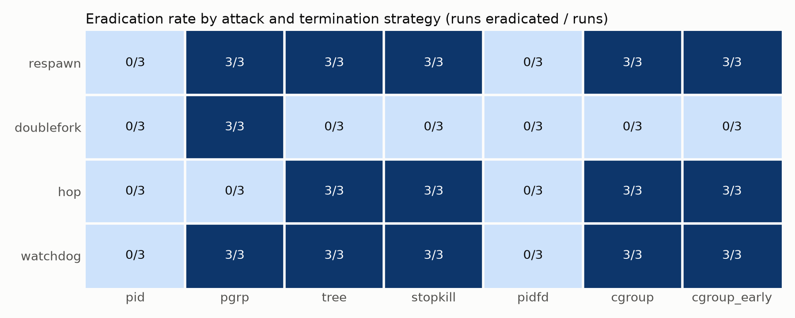
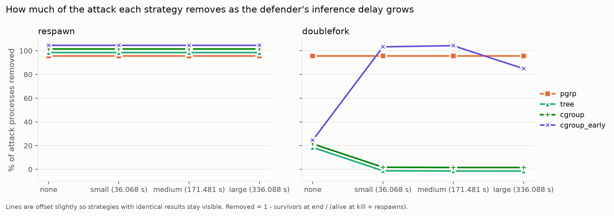

# Termination Is a Race

**Operating Systems — Final Project: Applied OS, Cyber Defense and AI Agents**
Zoya Imran (zi10204) · Zaara Ahmad (za10196) · Humna Khan (hk09629) — Section L4

## Quick start

Inside a Linux VM or WSL2 with cgroup v2 (see [Requirements](#requirements)):

```bash
git clone https://github.com/zaaraahmad1/OS-Project---Termination-Is-A-Race.git
cd OS-Project---Termination-Is-A-Race
make -C red_team                       # build the 4 attacks
gcc -Wall defender.c -o defender       # build the defender
sudo ./run_harness.sh --technique respawn --strategy cgroup --reps 1   # one experiment (~2 s)
python3 summarize_results.py           # rebuild tables + figures from our results
```

To reproduce every experiment (about 4.5 hours), see
[Run the full experiment plan](#run-the-full-experiment-plan). Our own
results are already in [`results/`](results/) and summarised in
[Results](#results).

## Contents

1. [Research question](#research-question)
2. [Repository layout](#repository-layout)
3. [Requirements](#requirements)
4. [Build](#build)
5. [Run the full experiment plan](#run-the-full-experiment-plan)
6. [Run one experiment](#run-one-experiment): options, strategies, targeting
7. [Using real LLM decision times](#using-real-llm-decision-times)
8. [Output: the result CSVs](#output-the-result-csvs)
9. [Measured LLM decision times](#measured-llm-decision-times)
10. [Results](#results): tables, hypotheses, figures
11. [Design notes](#design-notes)
12. [Limitations](#limitations)
13. [Cleaning up after an interrupted run](#cleaning-up-after-an-interrupted-run)

## Research question

When an LLM endpoint defender decides to terminate a malicious process, how
reliably does it actually remove the threat if the malware resists
termination?

We compare **6 termination strategies** against **4 termination-resistance
techniques**, while varying the attacker's fork rate, CPU contention, and
the defender's inference delay (measured from small, medium and large local
models). For every run we record whether the attack was fully removed, how
long that took, how many processes came back, and whether innocent
processes were killed by mistake.

OS core elements covered: **Concurrency** (the kill loop races the fork
loop), **Scheduling** (CPU contention decides who runs first) and
**Security** (process groups, sessions, reparenting, pidfd, cgroup v2).

> ⚠️ **Safety:** `red_team/` contains programs designed to resist being
> killed. Run this project only inside a disposable VM or WSL2 instance,
> never on a shared machine. The harness caps every run with a cgroup
> `pids.max` limit and a hard timeout.

## Repository layout

```
.
├── README.md                  this file
├── red_team/                  the 4 termination-resistant attacks (C) + Makefile
│   ├── respawn.c  doublefork.c  hop.c  watchdog.c
│   └── Makefile
├── defender.c                 the 6 termination strategies (C)
├── run_matrix.sh              runs the whole experiment plan (phases A-F)
├── run_harness.sh             runs one experiment configuration
├── count_survivors.sh         independent count of surviving attack processes
├── cpu_contention.sh          CPU load presets
├── benign_workload.sh         innocent processes (collateral-damage check)
├── capture_snapshot.sh        telemetry snapshot for the LLM
├── measure_llm_delay.sh       times each model's kill decision
├── summarize_results.py       CSVs -> summary.md + figures
├── snap.json                  the snapshot our delays were measured on
├── delays.txt                 measured delays (and delays_cached_prompt.txt)
└── results/                   our experiment data
    ├── A_baseline.csv         every attack x every strategy
    ├── B_fork_rate.csv        fork rate 2 and 50/s
    ├── C_cpu_load.csv         medium and high CPU load
    ├── D_delay.csv            the three measured LLM delays
    ├── E_benign_share.csv     benign processes share the attacker's group
    ├── F_target_newest.csv    detector flags the newest process
    ├── check_outlier.csv      repeat of one outlier run
    ├── matrix_*.log           full log of every run
    ├── summary.md             all result tables, by hypothesis
    └── figures/
        ├── fig1_baseline_heatmap.png   eradication rate, attack x strategy
        ├── fig2_fork_rate.png          eradication rate vs fork rate
        ├── fig3_cpu_load.png           time to clear under CPU load
        ├── fig4_delay.png              share of attack removed vs LLM delay
        └── fig5_benign_harm.png        innocent processes killed
```

| Path | What it is |
|---|---|
| `red_team/respawn.c` | Attack 1, **fork-respawn racing**: the parent keeps one child alive and immediately forks a replacement whenever it dies |
| `red_team/doublefork.c` | Attack 2, **double-fork escape**: forks a child that forks a grandchild and exits, so the grandchild is reparented to init and leaves the original process tree |
| `red_team/hop.c` | Attack 3, **session/process-group hopping**: the child calls `setsid()` and moves into its own new session and process group |
| `red_team/watchdog.c` | Attack 4, **paired watchdogs**: two processes that each restart the other when it dies |
| `red_team/Makefile` | Builds the four attacks |
| `defender.c` | The defender: applies one of the 6 termination strategies to a target PID |
| `run_matrix.sh` | **Runs the whole experiment plan** (phases A–F below) with one command; resumable |
| `run_harness.sh` | Runs one experiment configuration for N repetitions and appends one row per repetition to a CSV |
| `count_survivors.sh` | Independent ground truth: counts the attack processes still alive, without trusting the defender's own report |
| `cpu_contention.sh` | CPU load presets: `idle`, `medium` (half the cores busy), `high` (all cores busy) |
| `benign_workload.sh` | Innocent background processes, used to detect wrongful terminations |
| `capture_snapshot.sh` | Runs an attack briefly and saves the system's process list as JSON telemetry for the LLM |
| `measure_llm_delay.sh` | Measures how long TinyLlama / Llama-3.2 3B / Llama-3.1 8B take to make a kill decision |
| `summarize_results.py` | Turns the result CSVs into `results/summary.md` (tables) and `results/figures/` (report figures) |
| `results/` | Experiment output: one CSV per phase, the full run log, `summary.md` and `figures/` |
| `results/check_outlier.csv` | Repeat of one outlier run with a longer timeout (see Results) |
| `snap.json` | The telemetry snapshot (a running `respawn` attack) the LLM delays were measured on |
| `delays.txt` | Measured LLM decision times (median of 3 runs per model) |
| `delays_cached_prompt.txt` | An earlier measurement with Ollama's prompt cache active; kept to show why it was redone |

## Requirements

- Linux with **cgroup v2** mounted at `/sys/fs/cgroup` (WSL2 and modern
  distributions) and kernel **5.14 or newer** (for `cgroup.kill`)
- `gcc`, `make`, `procps` (`pgrep`, `ps`), `util-linux` (`setsid`, `taskset`), `python3`
- `sudo` access (creating cgroups requires root)
- For the LLM delay measurement only: [Ollama](https://ollama.com) with
  `tinyllama:latest`, `llama3.2:3b` and `llama3.1:8b` pulled, and a Python
  virtual environment with `requests` (the `ai-agent-env` from Project Part 1)

Check your machine once:

```bash
uname -r                                     # 5.14 or newer
mount | grep cgroup2                         # cgroup2 on /sys/fs/cgroup type cgroup2 ...
cat /sys/fs/cgroup/cgroup.controllers        # must include: pids
```

## Build

```bash
make -C red_team
gcc -Wall defender.c -o defender
chmod +x *.sh
```

## Run the full experiment plan

```bash
./run_matrix.sh --dry-run                       # list every configuration + time estimate
sudo ./run_matrix.sh --delay-small 36068 --delay-medium 171481 --delay-large 336088
python3 summarize_results.py                    # tables + figures from results/
```

The `--delay-*` values are the LLM decision times we measured with
`measure_llm_delay.sh` (see *Measured LLM decision times* below); without
them phase D is skipped. Each phase writes its own CSV:

| Phase | File | What varies | Hypothesis |
|---|---|---|---|
| A | `A_baseline.csv` | all 4 attacks x all 7 strategies (fork rate 10, idle CPU, no delay) | H1, H2, H3 |
| B | `B_fork_rate.csv` | fork rate 2 and 50 per second (`respawn`, `doublefork`, `watchdog`) | H1 |
| C | `C_cpu_load.csv` | medium and high CPU contention | scheduling |
| D | `D_delay.csv` | the three measured LLM inference delays (`respawn`, `doublefork`) | H4 |
| E | `E_benign_share.csv` | benign processes share the attacker's group and cgroup | H5 |
| F | `F_target_newest.csv` | detector flags the newest process instead of the parent | sensitivity |

The matrix runs every configuration 3 times with a 10-second timeout: every
successful kill in testing cleared in well under a second, and no attack
ever dies on its own. If it is interrupted, run the same command again: it
skips repetitions already in the CSVs. `--phases A,E` runs only some phases;
`--reps` and `--timeout-s` override the defaults.

## Run one experiment

```bash
sudo ./run_harness.sh --technique respawn --strategy cgroup --reps 3
```

Each repetition prints what happened and appends one row to `results.csv`:

```
[harness] run_id=respawn_cgroup_10_0_1 target=parent cpu_load=idle benign_share=0
[harness] attacker root pid=4211, detector flags pid=4211 (parent)
[defender] strategy=cgroup: moved 2/2 descendant(s) into quarantine
[defender] strategy=cgroup: froze quarantine group
[defender] strategy=cgroup: issued cgroup.kill
[harness] eradicated=1 time_to_clear_ms=45 respawns=0 benign_killed=0/3 alive_at_kill=2 survivors_at_end=0 valid=1
```

### Options

| Option | Values (default) | Meaning |
|---|---|---|
| `--technique` | `respawn` `doublefork` `hop` `watchdog` | Which attack to run (required) |
| `--strategy` | `pid` `pgrp` `tree` `stopkill` `pidfd` `cgroup` `cgroup_early` | Which termination strategy to use (required) |
| `--fork-rate` | number (`10`) | Attacker forks per second (for `watchdog`: partner checks per second) |
| `--cpu-load` | `idle` `medium` `high` (`idle`) | CPU contention preset |
| `--delay-ms` | number (`0`) | Defender inference delay between detection and kill |
| `--llm-mode` | `off` `small` `medium` `large` (`off`) | Label recording which model's measured delay was used |
| `--target` | `parent` `newest` (`parent`) | Which PID the simulated detector flags (see below) |
| `--benign-count` | number (`3`) | Number of innocent background processes |
| `--benign-share` | flag | Start the benign processes inside the attacker's group (Hypothesis 5) |
| `--reps` | number (`3`) | Repetitions of this configuration |
| `--timeout-s` | number (`60`) | Seconds after the kill before the run is declared a failure |
| `--settle-ms` | number (`300`) | How long the attack runs undetected before detection |
| `--pids-max` | number (`500`) | Safety cap on attacker processes per run |
| `--operator` | text (`Zaara`) | Who ran the experiment |
| `--results-csv` | path (`results.csv`) | Output file |
| `--cgroup-base` | path (`/sys/fs/cgroup/harness_run`) | Prefix for per-run cgroups, if cgroup2 is mounted elsewhere |

### The termination strategies

| Strategy | What the defender does |
|---|---|
| `pid` | `kill(pid, SIGKILL)` on the target only (baseline: how the Part 3 defender responded) |
| `pgrp` | `killpg()`: kills the target's whole process group |
| `tree` | Walks `/proc` to find every descendant of the target, then kills them all |
| `stopkill` | `SIGSTOP`s the whole tree first (so nothing can fork), re-scans, then `SIGKILL`s everything |
| `pidfd` | `pidfd_open()` + `pidfd_send_signal()`: race-free against PID reuse, but still one process |
| `cgroup` | Waits out the delay, moves the target's tree into a new quarantine cgroup, writes `cgroup.freeze` then `cgroup.kill` |
| `cgroup_early` | Moves the target into quarantine **at detection time**, waits out the delay, then freezes and kills. Every child forked during the delay is born inside the quarantine (Hypothesis 4's exception) |

### Which PID the detector flags (`--target`)

- `parent` (default): the attack's original process, the program a detector
  would identify as malicious.
- `newest`: the most recently created attack process. Strategies that work
  downward through the process tree (`tree`, `stopkill`, `cgroup`) can never
  reach **up** to the parent from a child. Against `respawn`, `hop` and
  `watchdog` almost everything then fails, because the surviving parent or
  partner recreates what was killed. This shows that "kill the malicious
  process" is ambiguous about *which* process in a family, and that choice
  changes which strategy wins.

## Using real LLM decision times

```bash
source ~/ai-agent-env/bin/activate
./capture_snapshot.sh --technique respawn --out snap.json        # telemetry for the model
./measure_llm_delay.sh --model small  --telemetry-json snap.json --runs 3
./measure_llm_delay.sh --model medium --telemetry-json snap.json --runs 3
./measure_llm_delay.sh --model large  --telemetry-json snap.json --runs 3
```

Each prints `DELAY_MS <median>`. An untimed warm-up call loads the model
first, so the number measures thinking time, not model loading. Use the
result as the delay:

```bash
DELAY=$(./measure_llm_delay.sh --model medium --telemetry-json snap.json | awk '{print $2}')
sudo ./run_harness.sh --technique doublefork --strategy cgroup_early \
     --delay-ms "$DELAY" --llm-mode medium --reps 3
```

Most runs use a scripted delay (`--llm-mode off`) so the LLM's varying
answers don't affect the OS-level comparison.

## Output: the result CSVs

One row per repetition. The first 14 columns are the format agreed in the
project plan; the last 5 were added during implementation.

| Column | Meaning |
|---|---|
| `run_id` | `<technique>_<strategy>_<fork_rate>_<delay_ms>_<rep>` |
| `timestamp` | UTC start time of the repetition |
| `technique`, `strategy`, `fork_rate`, `cpu_load`, `llm_mode`, `delay_ms` | The configuration |
| `eradicated` | `1` if the survivor count reached 0 before the timeout |
| `time_to_clear_ms` | From the kill being issued until 0 survivors (excludes the delay); blank if never cleared |
| `respawns` | Attack PIDs that appeared **after** the kill was issued |
| `benign_killed`, `benign_total` | Innocent processes killed / started |
| `operator` | Who ran it |
| `target` | `parent` or `newest` |
| `benign_share` | `1` if the benign processes shared the attacker's group |
| `valid` | `0` if the strategy could not be applied as requested; exclude these rows |
| `alive_at_kill` | Attack processes alive when the kill was issued (how far it spread during the delay) |
| `survivors_at_end` | Attack processes still alive at the timeout (0 if eradicated) |

## Measured LLM decision times

Measured with `measure_llm_delay.sh` on `snap.json` (a running `respawn`
attack), 3 timed runs per model after an untimed warm-up, on the machine
listed under Results. Each decision is the full two-call pattern from
Project Part 3: telemetry analysis, then the PID choice.

| `--llm-mode` | Model | Delay used | PID chosen |
|---|---|---|---|
| `small` | `tinyllama:latest` (1.1B) | **36,068 ms** | none: output never parsed as a PID (3/3 runs) |
| `medium` | `llama3.2:3b` | **171,481 ms** (median) | 47015, the `respawn` **child** (3/3) |
| `large` | `llama3.1:8b` | **336,088 ms** (median) | 47013, the `respawn` **parent** (3/3) |

Notes:

- **Prompt caching.** The first measurement (`delays_cached_prompt.txt`)
  sent an identical prompt every run, so Ollama reused its processing of
  that prompt and runs 2–3 were 2–4× faster than run 1. A real defender
  sees new telemetry every cycle, so each run's prompt now starts with a
  unique line, and those runs became consistent (`delays.txt`).
- **TinyLlama.** Its runs 2–3 stayed fast even with the unique line. Its
  context window is 2,048 tokens, which the telemetry most likely
  exceeds, so Ollama truncates the beginning of the prompt (instructions
  and unique line included). That would also explain why it never named a
  PID. We therefore used its first, uncached run (36,068 ms) rather than
  the median of 22,605 ms in `delays.txt`.
- **Which PID the model flags matters.** The 3B model flagged the child,
  and phase F shows every strategy then fails against `respawn`. The 8B
  model flagged the parent, which `tree`, `stopkill` and `cgroup`
  eradicate, but it took twice as long.

## Results

396 runs (132 configurations x 3 repetitions), all valid. Full tables are in
[`results/summary.md`](results/summary.md), raw data in `results/*.csv`.

**Machine:** Intel Core i5-8365U (4 cores / 8 threads, 1.60 GHz), 7.8 GiB RAM
available to WSL2 (+ 2 GiB swap), Windows host, WSL2 kernel
6.18.33.2-microsoft-standard-WSL2, cgroup v2, CPU-only Ollama inference (no GPU).

### Every attack against every strategy (phase A)

Eradicated runs out of 3; target = the attack's parent, fork rate 10/s,
idle CPU, no delay.

| technique | pid | pgrp | tree | stopkill | pidfd | cgroup | cgroup_early |
|---|---|---|---|---|---|---|---|
| respawn | 0/3 | 3/3 | 3/3 | 3/3 | 0/3 | 3/3 | 3/3 |
| doublefork | 0/3 | **3/3** | 0/3 | 0/3 | 0/3 | 0/3 | 0/3 |
| hop | 0/3 | **0/3** | 3/3 | 3/3 | 0/3 | 3/3 | 3/3 |
| watchdog | 0/3 | 3/3 | 3/3 | 3/3 | 0/3 | 3/3 | 3/3 |



### Hypotheses

| | Hypothesis | Result |
|---|---|---|
| H1 | Per-PID and pidfd fail against fork-respawn above a fork-rate threshold | **Partly supported.** They failed at every fork rate tested (2, 10, 50/s), so there was no threshold: killing only the parent leaves the child running as an orphan. Fork rate changed how much survived (`doublefork`: about 1, 4, 19 survivors) but never the outcome. |
| H2 | Process-group kill fails against hopping; tree walk fails against double-fork | **Confirmed.** `pgrp` vs `hop` 0/3; `tree` vs `doublefork` 0/3. |
| H3 | Quarantine cgroup has the highest eradication rate, except for children forked before the move | **Partly supported.** `cgroup` tied with `pgrp`, `tree` and `stopkill` (9/12 each) and was the slowest to clear (44–55 ms vs 24–34 ms). It failed against `doublefork` exactly through the predicted escape window: the ~4 survivors are grandchildren born before the move. |
| H4 | Longer inference delay lowers every strategy's success, unless the suspect is quarantined at detection time | **Confirmed.** During the delay `doublefork` grew from 5 processes to 363 (small), 1,705 (medium) and the 2,000 cap (large); `tree` and `cgroup` removed almost none of them. `cgroup_early` kept survivors at about 4 at every delay (99.8% removed at the medium delay). `pgrp` eradicated it at every delay. |
| H5 | Broad strategies kill benign processes sharing the attacker's group or cgroup | **Confirmed.** With shared benign processes, `pgrp`, `tree` and `cgroup` killed 9/9 of them and `pid` 0/9. With separate benign processes, no strategy ever killed one. |



### Other findings

- **CPU contention** made kills 3–4x slower (about 25 ms idle to 90–135 ms
  under high load) but changed the outcome only once: `tree` vs `watchdog`
  under high load lost 1 of 3 runs, when the partner restarted between the
  scan and the kill. `stopkill`, which freezes everything first, won all 3.
- **Targeting the newest process** instead of the parent (phase F) gave
  0/48: strategies that work down the process tree cannot reach the
  surviving parent or partner.
- **Launch-time containment beat every strategy.** No termination strategy
  defeated all four attacks, but the harness's own per-run cgroup, which
  each attack ran in from launch, removed everything at teardown,
  escaped `doublefork` grandchildren included.
- **One outlier.** One `cgroup_early` vs `doublefork` run at the large
  delay recorded 1,171 survivors at the 10-second timeout with no new
  processes created. A repeat with a 60-second timeout
  (`results/check_outlier.csv`) left 4 survivors, matching the other runs,
  so the kernel had most likely not finished removing ~2,000 frozen
  processes within 10 seconds.

## Design notes

- **Survivors are found by command line, not by environment variable.** The
  plan proposed matching a `MARK` tag in `/proc/<pid>/environ`. The attacks
  set `MARK` with `setenv()` after they start, which changes only the
  process's heap copy of the environment; `/proc/<pid>/environ` always shows
  the original exec-time block, so the tag never appears there. Since no
  attack calls `exec()` again, every descendant keeps the original command
  line (`.../red_team/<attack> ... --tag <TAG>`), which `count_survivors.sh`
  matches with `pgrep`. Zombies are not counted (already dead); stopped
  processes are counted (still alive). The attacks still set `MARK`, and
  their header comments describe finding it in `/proc`; that was the
  original plan, and the harness no longer relies on it.
- **The attacker runs in its own session and process group** (`setsid`),
  as malware launched independently would. Otherwise a process-group kill
  would also kill the harness. As an extra safeguard, the defender refuses
  to `killpg()` its own group.
- **The whole attack lives inside a capped cgroup** from its first
  instruction, so `pids.max` limits every descendant, and teardown
  (`cgroup.kill`) removes everything, including escaped processes.
- **The harness owns the inference delay.** It waits out `--delay-ms`,
  snapshots the live attack processes, then calls the defender with no
  delay. This is what lets `time_to_clear_ms` and `respawns` be measured
  from the moment of the kill.
- **Invalid runs are flagged, not hidden.** If a strategy cannot be applied
  (for example the quarantine cgroup cannot be created), the defender falls
  back to a weaker strategy, says so, and the row is written with
  `valid=0`.

## Limitations

- `respawn` and `hop` only fork a replacement after their child dies, so
  for them the fork rate is a respawn delay rather than a continuous fork
  rate. A single kill either succeeds or fails at every fork rate; there is
  no threshold for Hypothesis 1 to find. Fork rate matters most for
  `doublefork`, whose escaped grandchildren accumulate continuously.
- `pidfd` and `pid` behave identically here. pidfd's advantage (it can never
  signal a recycled PID) only shows up under PID reuse, which these
  experiments don't produce.
- Timings come from a WSL2 guest and are affected by the Windows host.
- `doublefork` hits the 2,000-process safety cap during the large delay, so
  its growth levels off at about 2,000.
- 3 repetitions per configuration; outcomes were almost always identical
  across repetitions, but small differences in timing should not be
  over-interpreted.
- The defender is given the suspect PID; detection quality is not part of
  this project (that was Project Part 3).

## Cleaning up after an interrupted run

`run_harness.sh` clears leftovers from earlier runs every time it starts.
To clean up by hand:

```bash
sudo pkill -9 -f '/red_team/(respawn|doublefork|hop|watchdog) '
for d in /sys/fs/cgroup/harness_run_* /sys/fs/cgroup/quarantine_*; do
  [ -d "$d" ] && { echo 1 | sudo tee "$d/cgroup.kill" >/dev/null; sleep 0.2; sudo rmdir "$d"; }
done
```
